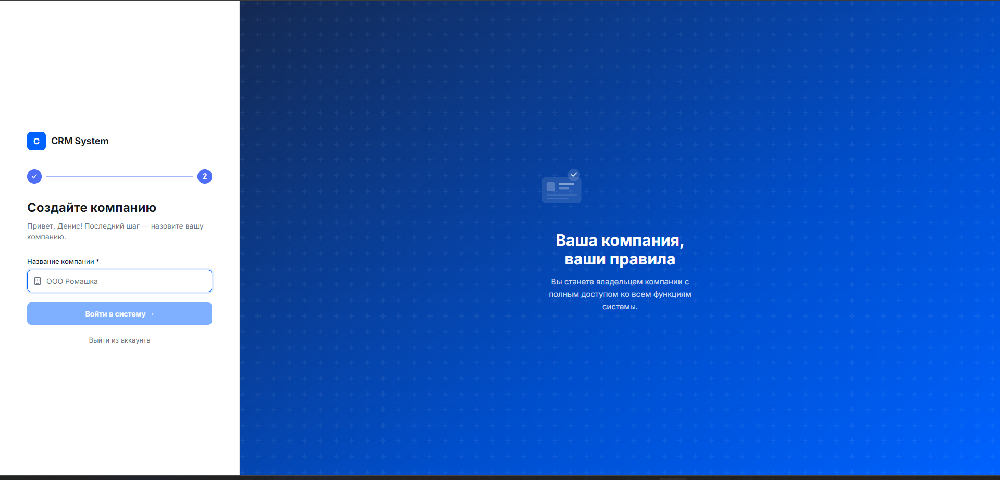
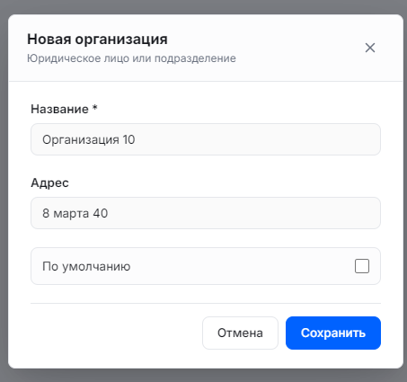
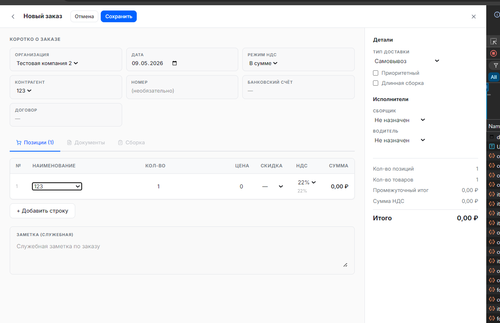

# Smoke-сценарии (baseline) для CRM_system

> Назначение: быстрый ручной чек-лист, который прогоняется после каждого этапа рефакторинга/добавления фич.  
> Принцип: **если какой-то сценарий ломается — фиксить в этом же PR**, не копить долги.

## Как прогонять

- **Окружение**
  - Backend: `http://localhost:5035`
  - Frontend: Vite (обычно `http://localhost:5173`)
  - База: PostgreSQL (`docker compose up -d` или локально через `psql`), запуск через `./run.ps1`
- **Роли/права**
  - Owner/Basic: полный доступ
  - Editor (`isAccessOrdersEdit`): создание/редактирование заказов
  - Picker (`isOrderPicker`): закрытие чек-листа сборки (только в `Picking`)
  - Driver (`isDriver`): просмотр заказов
- **Что фиксировать при прогоне**
  - Время прогона
  - Версию/ветку
  - Что сломалось (шаг, сообщение ошибки, статус HTTP)
  - Скриншоты (если UI)

---

## 0. Подготовка данных (однократно на прогон)

### 0.1 Запуск системы
**Шаги**
1. Запусти `./run.ps1`.
2. Убедись, что backend поднялся.

**Ожидаемо**
- `GET /api/v1/health` → `200 { status: "ok" }`.
- UI доступен по адресу Vite.

**Заметки/факт:**

---

## 1. Auth / Профиль / Компания

### 1.1 Регистрация пользователя
**Шаги**
1. Открой `/register`.
2. Заполни email + пароль, зарегистрируйся.

**Ожидаемо**
- Успешная регистрация.
- Переход на `/login` или автоматический вход (как реализовано сейчас).

**Заметки/факт:**
Request URL
http://localhost:5173/api/v1/auth/register
Request Method
POST
Status Code
200 OK

Payload
{"email":"samniev12345@mail.ru","password":"_Aa1234567890","fullName":"Денис Самниев","phone":"79659428087"}

Response
{
    "token": "eyJhbGciOiJIUzI1NiIsInR5cCI6IkpXVCJ9.eyJzdWIiOiI3NzI2YmQ1OC02M2VjLTQxMGMtYTgwYS00M2Y4MmNhZGY0YzgiLCJlbWFpbCI6InNhbW5pZXYxMjM0NUBtYWlsLnJ1IiwiaHR0cDovL3NjaGVtYXMueG1sc29hcC5vcmcvd3MvMjAwNS8wNS9pZGVudGl0eS9jbGFpbXMvbmFtZWlkZW50aWZpZXIiOiI3NzI2YmQ1OC02M2VjLTQxMGMtYTgwYS00M2Y4MmNhZGY0YzgiLCJodHRwOi8vc2NoZW1hcy54bWxzb2FwLm9yZy93cy8yMDA1LzA1L2lkZW50aXR5L2NsYWltcy9lbWFpbGFkZHJlc3MiOiJzYW1uaWV2MTIzNDVAbWFpbC5ydSIsImh0dHA6Ly9zY2hlbWFzLnhtbHNvYXAub3JnL3dzLzIwMDUvMDUvaWRlbnRpdHkvY2xhaW1zL25hbWUiOiLQlNC10L3QuNGBINCh0LDQvNC90LjQtdCyIiwiSXNDb21wYW55T3duZXIiOiJmYWxzZSIsIklzQmFzaWNQcm9maWxlIjoidHJ1ZSIsIklzQWNjZXNzT3JkZXJzRWRpdCI6ImZhbHNlIiwiSXNPcmRlclBpY2tlciI6ImZhbHNlIiwiSXNFeHBlZGl0b3IiOiJmYWxzZSIsIklzRHJpdmVyIjoiZmFsc2UiLCJJc0FjY2Vzc0NvbnRyYWN0b3JzIjoiZmFsc2UiLCJJc0FjY2Vzc0NvbnRyYWN0b3JzRWRpdCI6ImZhbHNlIiwiSXNBY2Nlc3NDb250cmFjdG9yRGlzY291bnRFZGl0IjoiZmFsc2UiLCJJc0FjY2Vzc05vbWVuY2xhdHVyZSI6ImZhbHNlIiwiSXNBY2Nlc3NOb21lbmNsYXR1cmVFZGl0IjoiZmFsc2UiLCJJc0FjY2Vzc0ZpbmFuY2lhbEpvdXJuYWwiOiJmYWxzZSIsIklzQWNjZXNzRmluYW5jaWFsSm91cm5hbEVkaXQiOiJmYWxzZSIsIklzQWNjZXNzV2FyZWhvdXNlcyI6ImZhbHNlIiwiSXNBY2Nlc3NXYXJlaG91c2VzRWRpdCI6ImZhbHNlIiwiZXhwIjoxNzc4MzI3OTQxLCJpc3MiOiJDcm1TeXN0ZW0uQXBpIiwiYXVkIjoiQ3JtU3lzdGVtLkNsaWVudCJ9.TR8CR95w3VVRoFb-TCXfkvv-siLheqx2AfB7vupE0FI",
    "profile": {
        "id": "7726bd58-63ec-410c-a80a-43f82cadf4c8",
        "email": "samniev12345@mail.ru",
        "fullName": "Денис Самниев",
        "phone": "79659428087",
        "companyId": null,
        "companyName": null,
        "isCompanyOwner": false,
        "isBasicProfile": true,
        "isAccessOrdersEdit": false,
        "isOrderPicker": false,
        "isExpeditor": false,
        "isDriver": false,
        "isAccessContractors": false,
        "isAccessContractorsEdit": false,
        "isAccessContractorDiscountEdit": false,
        "isAccessNomenclature": false,
        "isAccessNomenclatureEdit": false,
        "isAccessFinancialJournal": false,
        "isAccessFinancialJournalEdit": false,
        "isAccessWarehouses": false,
        "isAccessWarehousesEdit": false,
        "availableProfiles": [
            {
                "companyId": null,
                "name": "Денис Самниев",
                "role": "Личный",
                "isBasicProfile": true,
                "isCompanyOwner": false
            }
        ]
    }
}
### 1.2 Логин
**Шаги**
1. Открой `/login`.
2. Введи email + пароль.

**Ожидаемо**
- UI входит в систему.
- В `localStorage` появляется `crm_token`.

**Заметки/факт:**
Request URL
http://localhost:5173/api/v1/auth/login
Request Method
POST
Status Code
200 OK
payload
{"email":"samniev12345@mail.ru","password":"_Aa1234567890"}
response
{
    "token": "eyJhbGciOiJIUzI1NiIsInR5cCI6IkpXVCJ9.eyJzdWIiOiI3NzI2YmQ1OC02M2VjLTQxMGMtYTgwYS00M2Y4MmNhZGY0YzgiLCJlbWFpbCI6InNhbW5pZXYxMjM0NUBtYWlsLnJ1IiwiaHR0cDovL3NjaGVtYXMueG1sc29hcC5vcmcvd3MvMjAwNS8wNS9pZGVudGl0eS9jbGFpbXMvbmFtZWlkZW50aWZpZXIiOiI3NzI2YmQ1OC02M2VjLTQxMGMtYTgwYS00M2Y4MmNhZGY0YzgiLCJodHRwOi8vc2NoZW1hcy54bWxzb2FwLm9yZy93cy8yMDA1LzA1L2lkZW50aXR5L2NsYWltcy9lbWFpbGFkZHJlc3MiOiJzYW1uaWV2MTIzNDVAbWFpbC5ydSIsImh0dHA6Ly9zY2hlbWFzLnhtbHNvYXAub3JnL3dzLzIwMDUvMDUvaWRlbnRpdHkvY2xhaW1zL25hbWUiOiLQlNC10L3QuNGBINCh0LDQvNC90LjQtdCyIiwiSXNDb21wYW55T3duZXIiOiJmYWxzZSIsIklzQmFzaWNQcm9maWxlIjoidHJ1ZSIsIklzQWNjZXNzT3JkZXJzRWRpdCI6ImZhbHNlIiwiSXNPcmRlclBpY2tlciI6ImZhbHNlIiwiSXNFeHBlZGl0b3IiOiJmYWxzZSIsIklzRHJpdmVyIjoiZmFsc2UiLCJJc0FjY2Vzc0NvbnRyYWN0b3JzIjoiZmFsc2UiLCJJc0FjY2Vzc0NvbnRyYWN0b3JzRWRpdCI6ImZhbHNlIiwiSXNBY2Nlc3NDb250cmFjdG9yRGlzY291bnRFZGl0IjoiZmFsc2UiLCJJc0FjY2Vzc05vbWVuY2xhdHVyZSI6ImZhbHNlIiwiSXNBY2Nlc3NOb21lbmNsYXR1cmVFZGl0IjoiZmFsc2UiLCJJc0FjY2Vzc0ZpbmFuY2lhbEpvdXJuYWwiOiJmYWxzZSIsIklzQWNjZXNzRmluYW5jaWFsSm91cm5hbEVkaXQiOiJmYWxzZSIsIklzQWNjZXNzV2FyZWhvdXNlcyI6ImZhbHNlIiwiSXNBY2Nlc3NXYXJlaG91c2VzRWRpdCI6ImZhbHNlIiwiZXhwIjoxNzc4MzI4MTU3LCJpc3MiOiJDcm1TeXN0ZW0uQXBpIiwiYXVkIjoiQ3JtU3lzdGVtLkNsaWVudCJ9.TE-XNHiO5ps9NFduxqt-OqAlBLkAxPRyJxRftNHmdtA",
    "profile": {
        "id": "7726bd58-63ec-410c-a80a-43f82cadf4c8",
        "email": "samniev12345@mail.ru",
        "fullName": "Денис Самниев",
        "phone": "79659428087",
        "companyId": null,
        "companyName": null,
        "isCompanyOwner": false,
        "isBasicProfile": true,
        "isAccessOrdersEdit": false,
        "isOrderPicker": false,
        "isExpeditor": false,
        "isDriver": false,
        "isAccessContractors": false,
        "isAccessContractorsEdit": false,
        "isAccessContractorDiscountEdit": false,
        "isAccessNomenclature": false,
        "isAccessNomenclatureEdit": false,
        "isAccessFinancialJournal": false,
        "isAccessFinancialJournalEdit": false,
        "isAccessWarehouses": false,
        "isAccessWarehousesEdit": false,
        "availableProfiles": [
            {
                "companyId": null,
                "name": "Денис Самниев",
                "role": "Личный",
                "isBasicProfile": true,
                "isCompanyOwner": false
            }
        ]
    }
}
### 1.3 Setup Company (создание компании)
**Шаги**
1. Если у пользователя нет компании — перейти на `/setup-company`.
2. Создать компанию (название + реквизиты по минимуму).

**Ожидаемо**
- Создана компания.
- После создания редирект на `/`.

**Заметки/факт:**

первая проблема что при нажатии создать компанию внутри страницы "Компании"
открывается отдельная страница которая выглядит как вход, создание компании должно происходить в модальном окне на той же странице

Request URL
http://localhost:5173/api/v1/auth/setup-company
Request Method
POST
Status Code
200 OK

payload 
{"companyName":"Тестовая компания 2"}

response 
{
    "token": "eyJhbGciOiJIUzI1NiIsInR5cCI6IkpXVCJ9.eyJzdWIiOiI3NzI2YmQ1OC02M2VjLTQxMGMtYTgwYS00M2Y4MmNhZGY0YzgiLCJlbWFpbCI6InNhbW5pZXYxMjM0NUBtYWlsLnJ1IiwiaHR0cDovL3NjaGVtYXMueG1sc29hcC5vcmcvd3MvMjAwNS8wNS9pZGVudGl0eS9jbGFpbXMvbmFtZWlkZW50aWZpZXIiOiI3NzI2YmQ1OC02M2VjLTQxMGMtYTgwYS00M2Y4MmNhZGY0YzgiLCJodHRwOi8vc2NoZW1hcy54bWxzb2FwLm9yZy93cy8yMDA1LzA1L2lkZW50aXR5L2NsYWltcy9lbWFpbGFkZHJlc3MiOiJzYW1uaWV2MTIzNDVAbWFpbC5ydSIsImh0dHA6Ly9zY2hlbWFzLnhtbHNvYXAub3JnL3dzLzIwMDUvMDUvaWRlbnRpdHkvY2xhaW1zL25hbWUiOiLQlNC10L3QuNGBINCh0LDQvNC90LjQtdCyIiwiSXNDb21wYW55T3duZXIiOiJ0cnVlIiwiSXNCYXNpY1Byb2ZpbGUiOiJ0cnVlIiwiSXNBY2Nlc3NPcmRlcnNFZGl0IjoidHJ1ZSIsIklzT3JkZXJQaWNrZXIiOiJ0cnVlIiwiSXNFeHBlZGl0b3IiOiJ0cnVlIiwiSXNEcml2ZXIiOiJ0cnVlIiwiSXNBY2Nlc3NDb250cmFjdG9ycyI6InRydWUiLCJJc0FjY2Vzc0NvbnRyYWN0b3JzRWRpdCI6InRydWUiLCJJc0FjY2Vzc0NvbnRyYWN0b3JEaXNjb3VudEVkaXQiOiJ0cnVlIiwiSXNBY2Nlc3NOb21lbmNsYXR1cmUiOiJ0cnVlIiwiSXNBY2Nlc3NOb21lbmNsYXR1cmVFZGl0IjoidHJ1ZSIsIklzQWNjZXNzRmluYW5jaWFsSm91cm5hbCI6InRydWUiLCJJc0FjY2Vzc0ZpbmFuY2lhbEpvdXJuYWxFZGl0IjoidHJ1ZSIsIklzQWNjZXNzV2FyZWhvdXNlcyI6InRydWUiLCJJc0FjY2Vzc1dhcmVob3VzZXNFZGl0IjoidHJ1ZSIsImNvbXBhbnlJZCI6Ijc0ZTJlY2M1LTUyODQtNGUyMC04MTRjLTgyOGFmZGQ3ODA4MSIsImV4cCI6MTc3ODMyODMzMywiaXNzIjoiQ3JtU3lzdGVtLkFwaSIsImF1ZCI6IkNybVN5c3RlbS5DbGllbnQifQ.hZRg-JVs_q-GkG82w_qByrRQ6IyAKqpRWLvbg_dfXCY",
    "profile": {
        "id": "7726bd58-63ec-410c-a80a-43f82cadf4c8",
        "email": "samniev12345@mail.ru",
        "fullName": "Денис Самниев",
        "phone": "79659428087",
        "companyId": "74e2ecc5-5284-4e20-814c-828afdd78081",
        "companyName": "Тестовая компания 2",
        "isCompanyOwner": true,
        "isBasicProfile": true,
        "isAccessOrdersEdit": true,
        "isOrderPicker": true,
        "isExpeditor": true,
        "isDriver": true,
        "isAccessContractors": true,
        "isAccessContractorsEdit": true,
        "isAccessContractorDiscountEdit": true,
        "isAccessNomenclature": true,
        "isAccessNomenclatureEdit": true,
        "isAccessFinancialJournal": true,
        "isAccessFinancialJournalEdit": true,
        "isAccessWarehouses": true,
        "isAccessWarehousesEdit": true,
        "availableProfiles": [
            {
                "companyId": null,
                "name": "Денис Самниев",
                "role": "Личный",
                "isBasicProfile": true,
                "isCompanyOwner": false
            },
            {
                "companyId": "74e2ecc5-5284-4e20-814c-828afdd78081",
                "name": "Тестовая компания 2",
                "role": "Владелец",
                "isBasicProfile": false,
                "isCompanyOwner": true
            }
        ]
    }
}

вторая проблема что для создания компании потребоволось только название, хотя в сущности компании больше обязательных полей, здесь не доработка бека и фронта что они оба не требуют остальные данные 
### 1.4 Переключение профиля/компании (если доступно)
**Шаги**
1. Открыть UI управления профилями (если есть).
2. Переключить companyId / базовый профиль.

**Ожидаемо**
- Токен обновляется.
- Данные в UI меняются на данные выбранной компании.

**Заметки/факт:**
Request URL
http://localhost:5173/api/v1/auth/switch-company
Request Method
POST
Status Code
200 OK

payload 
{"companyId":null}

response 
{
    "token": "eyJhbGciOiJIUzI1NiIsInR5cCI6IkpXVCJ9.eyJzdWIiOiI3NzI2YmQ1OC02M2VjLTQxMGMtYTgwYS00M2Y4MmNhZGY0YzgiLCJlbWFpbCI6InNhbW5pZXYxMjM0NUBtYWlsLnJ1IiwiaHR0cDovL3NjaGVtYXMueG1sc29hcC5vcmcvd3MvMjAwNS8wNS9pZGVudGl0eS9jbGFpbXMvbmFtZWlkZW50aWZpZXIiOiI3NzI2YmQ1OC02M2VjLTQxMGMtYTgwYS00M2Y4MmNhZGY0YzgiLCJodHRwOi8vc2NoZW1hcy54bWxzb2FwLm9yZy93cy8yMDA1LzA1L2lkZW50aXR5L2NsYWltcy9lbWFpbGFkZHJlc3MiOiJzYW1uaWV2MTIzNDVAbWFpbC5ydSIsImh0dHA6Ly9zY2hlbWFzLnhtbHNvYXAub3JnL3dzLzIwMDUvMDUvaWRlbnRpdHkvY2xhaW1zL25hbWUiOiLQlNC10L3QuNGBINCh0LDQvNC90LjQtdCyIiwiSXNDb21wYW55T3duZXIiOiJmYWxzZSIsIklzQmFzaWNQcm9maWxlIjoidHJ1ZSIsIklzQWNjZXNzT3JkZXJzRWRpdCI6InRydWUiLCJJc09yZGVyUGlja2VyIjoidHJ1ZSIsIklzRXhwZWRpdG9yIjoidHJ1ZSIsIklzRHJpdmVyIjoidHJ1ZSIsIklzQWNjZXNzQ29udHJhY3RvcnMiOiJ0cnVlIiwiSXNBY2Nlc3NDb250cmFjdG9yc0VkaXQiOiJ0cnVlIiwiSXNBY2Nlc3NDb250cmFjdG9yRGlzY291bnRFZGl0IjoidHJ1ZSIsIklzQWNjZXNzTm9tZW5jbGF0dXJlIjoidHJ1ZSIsIklzQWNjZXNzTm9tZW5jbGF0dXJlRWRpdCI6InRydWUiLCJJc0FjY2Vzc0ZpbmFuY2lhbEpvdXJuYWwiOiJ0cnVlIiwiSXNBY2Nlc3NGaW5hbmNpYWxKb3VybmFsRWRpdCI6InRydWUiLCJJc0FjY2Vzc1dhcmVob3VzZXMiOiJ0cnVlIiwiSXNBY2Nlc3NXYXJlaG91c2VzRWRpdCI6InRydWUiLCJleHAiOjE3NzgzMjg0NjksImlzcyI6IkNybVN5c3RlbS5BcGkiLCJhdWQiOiJDcm1TeXN0ZW0uQ2xpZW50In0.X6CAVhAxUn0GQgP7K7T67TwAB-NoU0EVz9Ey4B_XkUA",
    "profile": {
        "id": "7726bd58-63ec-410c-a80a-43f82cadf4c8",
        "email": "samniev12345@mail.ru",
        "fullName": "Денис Самниев",
        "phone": "79659428087",
        "companyId": null,
        "companyName": null,
        "isCompanyOwner": false,
        "isBasicProfile": true,
        "isAccessOrdersEdit": true,
        "isOrderPicker": true,
        "isExpeditor": true,
        "isDriver": true,
        "isAccessContractors": true,
        "isAccessContractorsEdit": true,
        "isAccessContractorDiscountEdit": true,
        "isAccessNomenclature": true,
        "isAccessNomenclatureEdit": true,
        "isAccessFinancialJournal": true,
        "isAccessFinancialJournalEdit": true,
        "isAccessWarehouses": true,
        "isAccessWarehousesEdit": true,
        "availableProfiles": [
            {
                "companyId": null,
                "name": "Денис Самниев",
                "role": "Личный",
                "isBasicProfile": true,
                "isCompanyOwner": false
            },
            {
                "companyId": "74e2ecc5-5284-4e20-814c-828afdd78081",
                "name": "Тестовая компания 2",
                "role": "Владелец",
                "isBasicProfile": false,
                "isCompanyOwner": true
            }
        ]
    }
}
вернулся из личного профиля в профиль компании 
Request URL
http://localhost:5173/api/v1/auth/switch-company
Request Method
POST
Status Code
200 OK

payload 
{"companyId":"74e2ecc5-5284-4e20-814c-828afdd78081"}
response 
{
    "token": "eyJhbGciOiJIUzI1NiIsInR5cCI6IkpXVCJ9.eyJzdWIiOiI3NzI2YmQ1OC02M2VjLTQxMGMtYTgwYS00M2Y4MmNhZGY0YzgiLCJlbWFpbCI6InNhbW5pZXYxMjM0NUBtYWlsLnJ1IiwiaHR0cDovL3NjaGVtYXMueG1sc29hcC5vcmcvd3MvMjAwNS8wNS9pZGVudGl0eS9jbGFpbXMvbmFtZWlkZW50aWZpZXIiOiI3NzI2YmQ1OC02M2VjLTQxMGMtYTgwYS00M2Y4MmNhZGY0YzgiLCJodHRwOi8vc2NoZW1hcy54bWxzb2FwLm9yZy93cy8yMDA1LzA1L2lkZW50aXR5L2NsYWltcy9lbWFpbGFkZHJlc3MiOiJzYW1uaWV2MTIzNDVAbWFpbC5ydSIsImh0dHA6Ly9zY2hlbWFzLnhtbHNvYXAub3JnL3dzLzIwMDUvMDUvaWRlbnRpdHkvY2xhaW1zL25hbWUiOiLQlNC10L3QuNGBINCh0LDQvNC90LjQtdCyIiwiSXNDb21wYW55T3duZXIiOiJ0cnVlIiwiSXNCYXNpY1Byb2ZpbGUiOiJ0cnVlIiwiSXNBY2Nlc3NPcmRlcnNFZGl0IjoidHJ1ZSIsIklzT3JkZXJQaWNrZXIiOiJ0cnVlIiwiSXNFeHBlZGl0b3IiOiJ0cnVlIiwiSXNEcml2ZXIiOiJ0cnVlIiwiSXNBY2Nlc3NDb250cmFjdG9ycyI6InRydWUiLCJJc0FjY2Vzc0NvbnRyYWN0b3JzRWRpdCI6InRydWUiLCJJc0FjY2Vzc0NvbnRyYWN0b3JEaXNjb3VudEVkaXQiOiJ0cnVlIiwiSXNBY2Nlc3NOb21lbmNsYXR1cmUiOiJ0cnVlIiwiSXNBY2Nlc3NOb21lbmNsYXR1cmVFZGl0IjoidHJ1ZSIsIklzQWNjZXNzRmluYW5jaWFsSm91cm5hbCI6InRydWUiLCJJc0FjY2Vzc0ZpbmFuY2lhbEpvdXJuYWxFZGl0IjoidHJ1ZSIsIklzQWNjZXNzV2FyZWhvdXNlcyI6InRydWUiLCJJc0FjY2Vzc1dhcmVob3VzZXNFZGl0IjoidHJ1ZSIsImNvbXBhbnlJZCI6Ijc0ZTJlY2M1LTUyODQtNGUyMC04MTRjLTgyOGFmZGQ3ODA4MSIsImV4cCI6MTc3ODMyODUxMiwiaXNzIjoiQ3JtU3lzdGVtLkFwaSIsImF1ZCI6IkNybVN5c3RlbS5DbGllbnQifQ.q-UNBuJLwbBcWC-be6TmX9S7Yg23YVDDl_jxkD70KBU",
    "profile": {
        "id": "7726bd58-63ec-410c-a80a-43f82cadf4c8",
        "email": "samniev12345@mail.ru",
        "fullName": "Денис Самниев",
        "phone": "79659428087",
        "companyId": "74e2ecc5-5284-4e20-814c-828afdd78081",
        "companyName": "Тестовая компания 2",
        "isCompanyOwner": true,
        "isBasicProfile": true,
        "isAccessOrdersEdit": true,
        "isOrderPicker": true,
        "isExpeditor": true,
        "isDriver": true,
        "isAccessContractors": true,
        "isAccessContractorsEdit": true,
        "isAccessContractorDiscountEdit": true,
        "isAccessNomenclature": true,
        "isAccessNomenclatureEdit": true,
        "isAccessFinancialJournal": true,
        "isAccessFinancialJournalEdit": true,
        "isAccessWarehouses": true,
        "isAccessWarehousesEdit": true,
        "availableProfiles": [
            {
                "companyId": null,
                "name": "Денис Самниев",
                "role": "Личный",
                "isBasicProfile": true,
                "isCompanyOwner": false
            },
            {
                "companyId": "74e2ecc5-5284-4e20-814c-828afdd78081",
                "name": "Тестовая компания 2",
                "role": "Владелец",
                "isBasicProfile": false,
                "isCompanyOwner": true
            }
        ]
    }
}
---

## 2. Справочники: Organizations / Counterparties / Items / Warehouses

### 2.1 Organizations — CRUD
**Шаги**
1. Открыть `/organizations`.
2. Создать организацию.
3. Обновить поля (название/адрес).
4. Удалить организацию.

**Ожидаемо**
- Создание/обновление/удаление работают.
- После удаления запись исчезает из списка (query filter `IsDeleted`).

**Заметки/факт:**

при создании организации в модальном окне чекбокс "По умолчанию", не понятна его суть 

создание 
Request URL
http://localhost:5173/api/v1/organizations
Request Method
POST
Status Code
201 Created

payload 
{"name":"Организация 10","address":"8 марта 40","isDefault":false}
response 
{
    "companyId": "74e2ecc5-5284-4e20-814c-828afdd78081",
    "company": null,
    "name": "Организация 10",
    "address": "8 марта 40",
    "isDefault": false,
    "createdAt": "2026-05-09T11:10:46.2803992+00:00",
    "createdBy": null,
    "updatedAt": "2026-05-09T11:10:46.2804001+00:00",
    "updatedBy": null,
    "isDeleted": false,
    "rowVersion": 1407,
    "id": "14409aae-c172-479b-8f5e-32ddb7ce3fc2"
}

обновление
Request URL
http://localhost:5173/api/v1/organizations/14409aae-c172-479b-8f5e-32ddb7ce3fc2
Request Method
PUT
Status Code
200 OK

payload 
{"name":"Организация 11","address":"8 марта 41","isDefault":false}

response
{
    "companyId": "74e2ecc5-5284-4e20-814c-828afdd78081",
    "company": null,
    "name": "Организация 11",
    "address": "8 марта 41",
    "isDefault": false,
    "createdAt": "2026-05-09T11:10:46.280399+00:00",
    "createdBy": null,
    "updatedAt": "2026-05-09T11:12:09.6418576+00:00",
    "updatedBy": null,
    "isDeleted": false,
    "rowVersion": 1408,
    "id": "14409aae-c172-479b-8f5e-32ddb7ce3fc2"
}

удаление 
Request URL
http://localhost:5173/api/v1/organizations/14409aae-c172-479b-8f5e-32ddb7ce3fc2
Request Method
DELETE
Status Code
204 No Content

### 2.2 Counterparties — CRUD
**Шаги**
1. Открыть `/counterparties`.
2. Создать контрагента (Name, Type, Status, Inn/Kpp/Ogrn при необходимости).
3. Обновить контрагента.
4. Удалить контрагента.

**Ожидаемо**
- CRUD работает.
- После удаления исчезает из списка.

**Заметки/факт:**

### 2.3 Items — CRUD
**Шаги**
1. Открыть `/items`.
2. Создать товар (SKU уникальный в компании), Unit, VatRate.
3. Обновить товар.
4. Удалить товар.

**Ожидаемо**
- Создание работает.
- Уникальность `(CompanyId, Sku)` соблюдается (при дубле — понятная ошибка).

**Заметки/факт:**
первая проблема в том что при создании модальное окно очень легко закрывается, при клике за пределами модального окна, нужно сделать подтверждение 
вторая проблема в том что в полях КПП и ИНН нет подсказок сколько цифр вводить 
пример заполнения должен быть указан в подсказке, но не как текст который нужно будет стирать перед вводом своих данных

Request URL
http://localhost:5173/api/v1/counterparties
Request Method
POST
Status Code
201 Created
Payload
{"name":"123","fullName":"1233","type":"Customer","status":"Active","inn":"123","kpp":"123","ogrn":"123","paymentTermsDays":123}
response
{
    "companyId": "74e2ecc5-5284-4e20-814c-828afdd78081",
    "type": "Customer",
    "status": "Active",
    "name": "123",
    "fullName": "1233",
    "inn": "123",
    "kpp": "123",
    "ogrn": "123",
    "paymentTermsDays": 123,
    "addresses": [],
    "contacts": [],
    "createdAt": "2026-05-09T11:18:51.8877432+00:00",
    "createdBy": null,
    "updatedAt": "2026-05-09T11:18:51.8877438+00:00",
    "updatedBy": null,
    "isDeleted": false,
    "rowVersion": 1410,
    "id": "85fb2454-3a71-4904-9cec-b2d3c6b12afe"
}

изменение 
Request URL
http://localhost:5173/api/v1/counterparties/85fb2454-3a71-4904-9cec-b2d3c6b12afe
Request Method
PUT
Status Code
200 OK
paload
{"name":"1234","fullName":"12334","type":"Supplier","status":"Blocked","inn":"1234","kpp":"1234","ogrn":"1234","paymentTermsDays":1234}
response
{
    "companyId": "74e2ecc5-5284-4e20-814c-828afdd78081",
    "type": "Supplier",
    "status": "Blocked",
    "name": "1234",
    "fullName": "12334",
    "inn": "1234",
    "kpp": "1234",
    "ogrn": "1234",
    "paymentTermsDays": 1234,
    "addresses": [],
    "contacts": [],
    "createdAt": "2026-05-09T11:18:51.887743+00:00",
    "createdBy": null,
    "updatedAt": "2026-05-09T11:19:46.1026049+00:00",
    "updatedBy": null,
    "isDeleted": false,
    "rowVersion": 1411,
    "id": "85fb2454-3a71-4904-9cec-b2d3c6b12afe"
}
удаление 
Request URL
http://localhost:5173/api/v1/counterparties/85fb2454-3a71-4904-9cec-b2d3c6b12afe
Request Method
DELETE
Status Code
204 No Content

### 2.4 Warehouses — CRUD (убрать и не вспоминать больше, при анализе должен был понять что в прототипе нет системы складов)
**Шаги**
1. Открыть `/warehouses`.
2. Создать склад.
3. Отметить склад `IsDefault` (если UI поддерживает).
4. Удалить склад.

**Ожидаемо**
- CRUD работает.
- В списке не более одного default (если правило реализовано).

**Заметки/факт:**

---

## 3. Остатки / Доступность товара (убрать и не вспоминать больше, при анализе должен был понять что в прототипе нет системы складов)

### 3.1 Stock — просмотр остатков
**Предусловия**
- Есть склад.
- Есть товар.
- Есть `StockBalance` (через seed или вручную в БД).

**Шаги**
1. Открыть `/stock`.
2. Найти строку товара на складе.

**Ожидаемо**
- Отображается корректный `QtyOnHand`.

**Заметки/факт:**

### 3.2 Заказ показывает доступное кол-во (Available = OnHand - Reserved)
**Предусловия**
- Есть заказ с позициями.

**Шаги**
1. Открыть список заказов.
2. Открыть детали заказа.

**Ожидаемо**
- Для каждой строки заказа отображается `AvailableQty`.

**Заметки/факт:**

---

## 4. Orders — основной жизненный цикл

### 4.1 Создание заказа (Draft)
**Предусловия**
- Есть контрагент.
- Есть минимум 1 товар.

**Шаги**
1. Открыть `/orders`.
2. Создать заказ с 1–2 позициями:
   - Qty, UnitPrice, VatRateSnapshot, DiscountType/DiscountValue.

**Ожидаемо**
- Заказ создаётся в статусе `Draft`.
- Суммы `TotalNet/TotalVat/TotalGross` посчитаны и отображаются.

**Заметки/факт:**

страница создания заказа очень не удобная 
нет поиска номенклатуры для добавления, нет поиска контрагента для добавления 
скидка не правильно сделана, в плане функциональности сейчас скидка не должна разделятся на процентную и числовую скидку, только проценты 
Так же я уверен что логика скидок не реализована также как сейчас в эталоне
в репозитории new-fimbiz-react сейчас лежит фронт crm системы можешь посмотреть как там реализованы скидки и все что нужно

Request URL
http://localhost:5173/api/v1/orders
Request Method
POST
Status Code
201 Created

payload 
{"number":null,"date":"2026-05-09","companyId":"74e2ecc5-5284-4e20-814c-828afdd78081","counterpartyId":"d514a814-4950-420b-a397-a0eb707c1c26","comment":null,"pickerId":null,"driverId":null,"bankAccount":null,"contract":null,"deliveryAddress":null,"rowVersion":null,"lines":[{"itemId":"fd4c866c-8a89-4b67-ad3f-3bb3373d5b7c","nameSnapshot":"123","vatRateSnapshot":"Vat22","qty":4,"unitPrice":5,"discountType":"Percent","discountValue":0,"warehouseId":null}]}

response 
{
    "id": "f3cd9ea1-0671-427e-86f5-9538eeb24901",
    "number": null,
    "date": "2026-05-09",
    "companyId": "74e2ecc5-5284-4e20-814c-828afdd78081",
    "companyName": "Тестовая компания 2",
    "counterpartyId": "d514a814-4950-420b-a397-a0eb707c1c26",
    "counterpartyName": "123",
    "status": "Draft",
    "comment": null,
    "totalNet": 20,
    "totalVat": 4.40,
    "totalGross": 24.40,
    "isAssemblyChecklistClosed": false,
    "pickerId": null,
    "driverId": null,
    "bankAccount": null,
    "contract": null,
    "deliveryAddress": null,
    "createdAt": "2026-05-09T11:31:09.7908219+00:00",
    "updatedAt": "2026-05-09T11:31:09.7908225+00:00",
    "lines": [
        {
            "id": "3b4c245c-aae5-484c-8d02-2a883809a8c7",
            "itemId": "fd4c866c-8a89-4b67-ad3f-3bb3373d5b7c",
            "itemName": "123",
            "nameSnapshot": "123",
            "vatRateSnapshot": "Vat22",
            "qty": 4,
            "unitPrice": 5,
            "discountType": "Percent",
            "discountValue": 0,
            "net": 20,
            "vat": 4.40,
            "gross": 24.40,
            "warehouseId": null,
            "availableQty": 0
        }
    ],
    "rowVersion": 0
}
проблема что модальное окно закрывается после создания 
а должен открыватся созданный заказ

так же режим нюс не меняется и ни на что не влияет стоит режим ндс в сумме а считается как сверху 

### 4.2 Обновление заказа (в не-locked статусе)
**Шаги**
1. Открыть созданный заказ.
2. Изменить comment, количество/цену в строке.
3. Сохранить.

**Ожидаемо**
- Заказ обновляется.
- Суммы пересчитаны.

**Заметки/факт:**
Request URL
http://localhost:5173/api/v1/orders/f3cd9ea1-0671-427e-86f5-9538eeb24901
Request Method
PUT
Status Code
200 OK

payload
{"number":null,"date":"2026-05-09","companyId":"74e2ecc5-5284-4e20-814c-828afdd78081","counterpartyId":"d514a814-4950-420b-a397-a0eb707c1c26","comment":null,"pickerId":null,"driverId":null,"bankAccount":null,"contract":null,"deliveryAddress":null,"rowVersion":0,"lines":[{"itemId":"fd4c866c-8a89-4b67-ad3f-3bb3373d5b7c","nameSnapshot":"123","vatRateSnapshot":"Vat10","qty":10,"unitPrice":10,"discountType":"Percent","discountValue":0,"warehouseId":null}]}

response
{
    "id": "f3cd9ea1-0671-427e-86f5-9538eeb24901",
    "number": null,
    "date": "2026-05-09",
    "companyId": "74e2ecc5-5284-4e20-814c-828afdd78081",
    "companyName": "Тестовая компания 2",
    "counterpartyId": "d514a814-4950-420b-a397-a0eb707c1c26",
    "counterpartyName": "123",
    "status": "Draft",
    "comment": null,
    "totalNet": 100,
    "totalVat": 10.0,
    "totalGross": 110.0,
    "isAssemblyChecklistClosed": false,
    "pickerId": null,
    "driverId": null,
    "bankAccount": null,
    "contract": null,
    "deliveryAddress": null,
    "createdAt": "2026-05-09T11:31:09.790821+00:00",
    "updatedAt": "2026-05-11T11:26:59.2260007+00:00",
    "lines": [
        {
            "id": "67f9294b-5868-442c-a5a5-237f920e1a34",
            "itemId": "fd4c866c-8a89-4b67-ad3f-3bb3373d5b7c",
            "itemName": "123",
            "nameSnapshot": "123",
            "vatRateSnapshot": "Vat10",
            "qty": 10,
            "unitPrice": 10,
            "discountType": "Percent",
            "discountValue": 0,
            "net": 100,
            "vat": 10.0,
            "gross": 110.0,
            "warehouseId": null,
            "availableQty": 0
        }
    ],
    "rowVersion": 0
}
### 4.3 Concurrency конфликт при обновлении
**Шаги**
1. Открыть один и тот же заказ в двух вкладках.
2. Вкладка A: поменять и сохранить.
3. Вкладка B: поменять и сохранить.

**Ожидаемо**
- Вкладка B получает `409 conflict` с кодом `concurrency_conflict` (или аналог).
- UI показывает понятную ошибку и предлагает обновить страницу.

**Заметки/факт:**
сначала обновил заказ в одной вкладке потом в другой 
без ошибок сохранилось последнее изменение
### 4.4 Confirm (Draft → Processing)
**Шаги**
1. В деталях заказа нажать `Confirm`.

**Ожидаемо**
- Статус меняется на `Processing`.

**Заметки/факт:**
нет кнопок перехода на следующий статус
### 4.5 Next status (линейный переход)
**Шаги**
1. Вызвать `Next status` несколько раз.
2. Протестировать 3 варианта `deliveryType`:
   - `selfPickup`
   - `companyDelivery`
   - `transportCompany`

**Ожидаемо**
- Статусы меняются по ожидаемой логике:
  - `selfPickup`: после `Picking` → `AwaitingPickup`
  - `companyDelivery`: после `Picking` → `Delivering`
  - `transportCompany`: `Picking → TransferredToTransport → DeliveringByTransport → AwaitingPickup`
- `Manufacturing` появляется только при дефиците доступного кол-ва.

**Заметки/факт:**
нет кнопок перехода на следующий статус
### 4.6 Cancel (любой не-финальный → Cancelled)
**Шаги**
1. Отменить заказ не в финальном статусе.

**Ожидаемо**
- Заказ переходит в `Cancelled`.
- Повторная отмена/отмена `Completed` → `409 invalid_transition`.

**Заметки/факт:**
нет кнопок отмены заказа
### 4.7 Close assembly checklist (Picker)
**Предусловия**
- Заказ в статусе `Picking`.
- Есть пользователь с ролью Picker (`isOrderPicker=true`).

**Шаги**
1. Зайти под Picker.
2. Открыть заказ.
3. Нажать «Закрыть чеклист сборки».

**Ожидаемо**
- 200 OK.
- `IsAssemblyChecklistClosed=true`.
- Picker не может редактировать заказ (кроме чеклиста).

**Заметки/факт:**

### 4.8 Driver view-only
**Предусловия**
- Есть пользователь Driver (`isDriver=true`).

**Шаги**
1. Зайти под Driver.
2. Открыть `/orders`.
3. Попробовать создать/изменить/удалить заказ.

**Ожидаемо**
- Просмотр доступен.
- Изменения запрещены (`403 Forbidden`).

**Заметки/факт:**

---

## 5. Invoices

### 5.1 Invoice — CRUD
**Шаги**
1. Открыть `/invoices`.
2. Создать счёт с 1–2 строками.
3. Обновить счёт.
4. Удалить счёт.

**Ожидаемо**
- CRUD работает.
- При отсутствии прав `IsAccessFinancialJournal` / `Edit` → 403.

**Заметки/факт:**

---

## 6. UPD

### 6.1 UPD — CRUD
**Шаги**
1. Открыть `/upds`.
2. Создать УПД с 1–2 строками.
3. Обновить.
4. Удалить.

**Ожидаемо**
- CRUD работает.

**Заметки/факт:**

---

## 7. Payments

### 7.1 Payment — CRUD
**Шаги**
1. Открыть `/payments`.
2. Создать входящий платёж.
3. Создать исходящий платёж.
4. Обновить/удалить.

**Ожидаемо**
- CRUD работает.
- Валидации по сумме/дате/статусу (если есть) соблюдаются.

**Заметки/факт:**

---

## 8. Users / права

### 8.1 Users — управление
**Предусловия**
- Пользователь Owner/Basic.

**Шаги**
1. Открыть `/users`.
2. Создать/пригласить пользователя (если UI поддерживает) или изменить права.
3. Убедиться, что права реально влияют на доступ.

**Ожидаемо**
- Пользователь без прав не видит/не может выполнять запрещённые действия.

**Заметки/факт:**

---

## 9. Негативные проверки (быстрые)

### 9.1 401 → редирект на логин
**Шаги**
1. Удалить `crm_token` из `localStorage`.
2. Обновить страницу.

**Ожидаемо**
- Редирект на `/login`.

**Заметки/факт:**

### 9.2 403 для запретных действий
**Шаги**
1. Под пользователем без `IsAccessOrdersEdit` попытаться:
   - `POST /api/v1/orders`
   - `PUT /api/v1/orders/{id}`

**Ожидаемо**
- `403 Forbidden`.

**Заметки/факт:**

---

## Итоги прогона (заполнять)

- **Дата/время:**
- **Ветка/коммит:**
- **Кто прогонял:**
- **Общее время прогона:**
- **Проваленные сценарии:**
  - 
- **Комментарии:**
  - 
